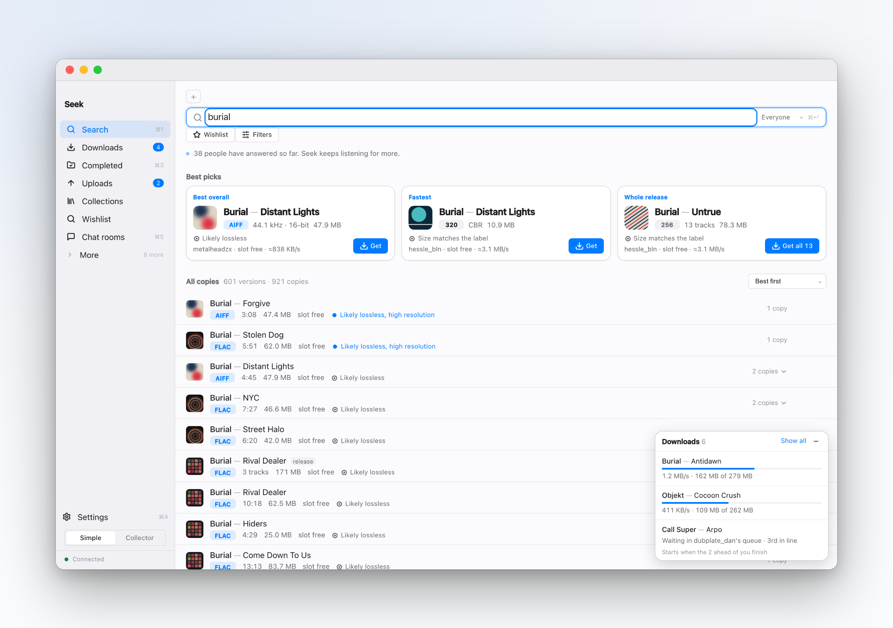
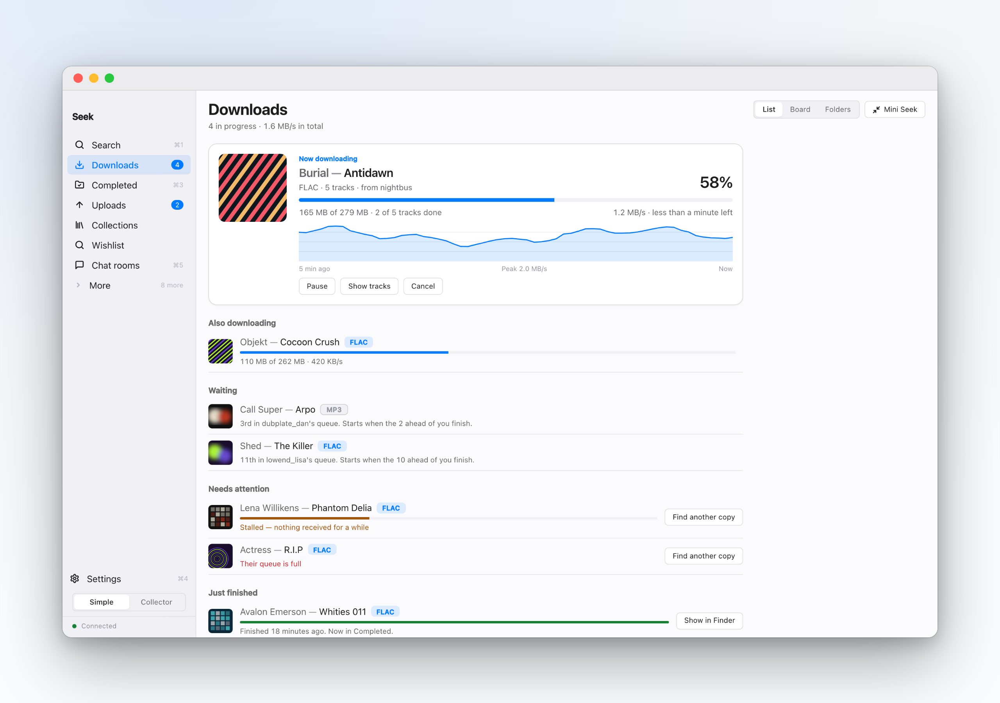
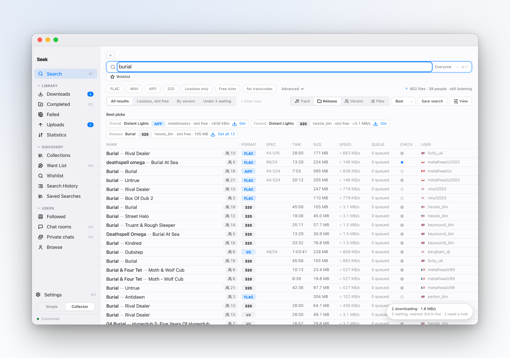
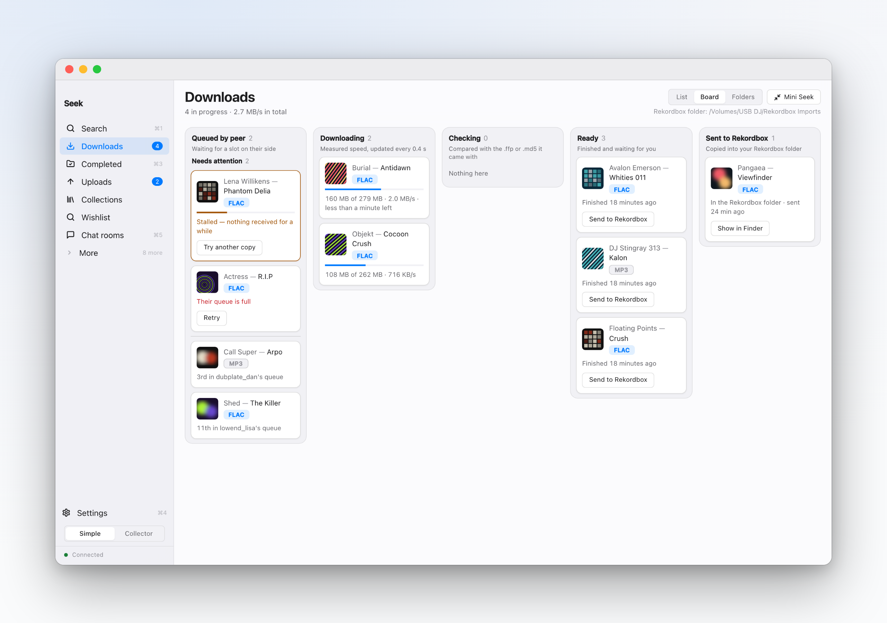
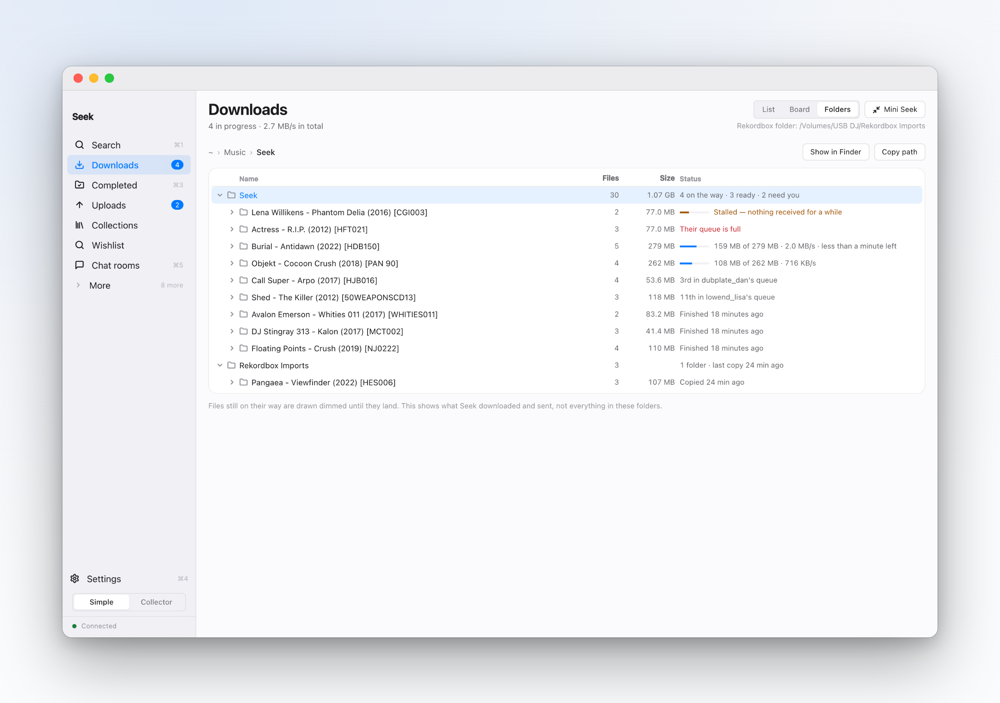
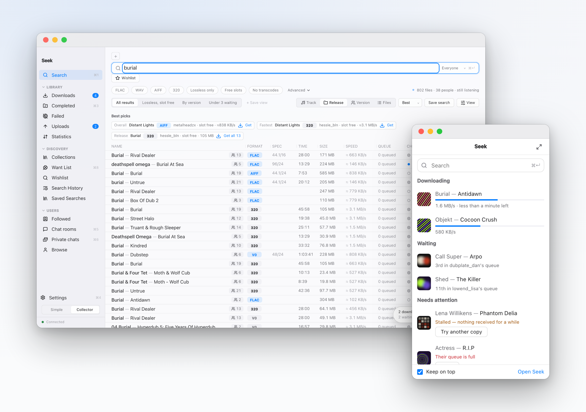
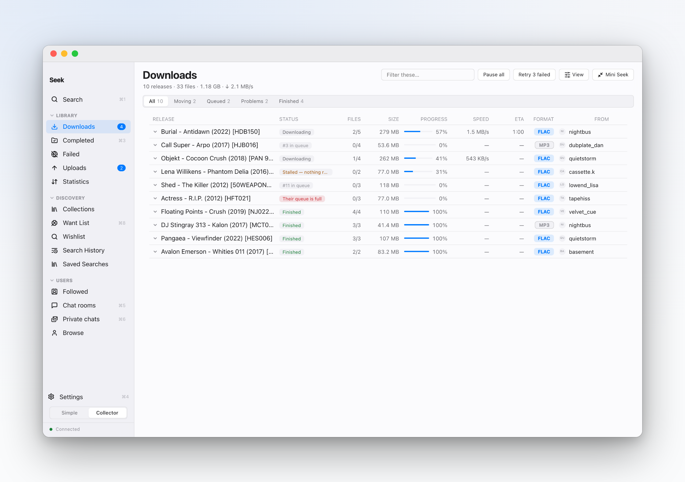

<p align="center">
  <picture>
    <source media="(prefers-color-scheme: dark)" srcset="docs/screenshots/0.4/hero-dark.png">
    
  </picture>
</p>

<h1 align="center">Seek</h1>

<p align="center">
  <b>Soulseek for the Mac, for people who dig.</b><br>
  Find the record. Know it's the right copy. Send it to Rekordbox.
</p>

<p align="center">
  <a href="../../releases/latest"><b>Download</b></a> ·
  <a href="#install">Install</a> ·
  <a href="#build-from-source">Build</a> ·
  <a href="../../releases/tag/v0.4.0">0.4 release notes</a>
</p>

---

- **Best picks.** Three copies worth taking (best overall, fastest, whole release), then every version once.
- **Get means that copy.** The row you're pointing at holds still, so nothing better can swap in mid-click.
- **Proof, not badges.** A size check before you download, a decoded spectrogram after, and `.ffp` and `.md5` checks when the uploader included them.
- **Downloads in plain words.** Your place in line, how long a stall has lasted, and what a refusal said. Shown as a list, a Board or Folders, with a corner panel and **Mini Seek** (⇧⌘M) to keep them in view.
- **Send to Rekordbox.** A finished release, copied into the folder you import from. Seek never touches the Rekordbox database.
- **Links become searches.** Paste a Discogs, Bandcamp or YouTube link, or open a label's whole catalogue and work down it.
- **Simple or Collector.** Cards and plain words, or the whole app as tables. Switch with ⌘\\.

<table>
<tr>
<td width="33%"><picture><source media="(prefers-color-scheme: dark)" srcset="docs/screenshots/0.4/downloads-simple-dark.png"></picture></td>
<td width="33%"><picture><source media="(prefers-color-scheme: dark)" srcset="docs/screenshots/0.4/search-collector-dark.png"></picture></td>
<td width="33%"><picture><source media="(prefers-color-scheme: dark)" srcset="docs/screenshots/0.4/downloads-board-dark.png"></picture></td>
</tr>
<tr>
<td align="center"><sub>Downloads</sub></td>
<td align="center"><sub>Collector search</sub></td>
<td align="center"><sub>Board, ending at Rekordbox</sub></td>
</tr>
<tr>
<td width="33%"><picture><source media="(prefers-color-scheme: dark)" srcset="docs/screenshots/0.4/downloads-folders-dark.png"></picture></td>
<td width="33%"><picture><source media="(prefers-color-scheme: dark)" srcset="docs/screenshots/0.4/mini-front-dark.png"></picture></td>
<td width="33%"><picture><source media="(prefers-color-scheme: dark)" srcset="docs/screenshots/0.4/downloads-collector-dark.png"></picture></td>
</tr>
<tr>
<td align="center"><sub>Folders, beside Rekordbox</sub></td>
<td align="center"><sub>Mini Seek, kept on top</sub></td>
<td align="center"><sub>Collector downloads</sub></td>
</tr>
</table>

Built on [Nicotine+](https://nicotine-plus.org/), which does the protocol work. Unofficial, and not affiliated with Soulseek or the Nicotine+ project.

## Install

Download the `.zip` from [Releases](../../releases/latest) and drag **Seek.app** to Applications. Seek isn't signed with a paid Apple certificate, so run this once:

```bash
xattr -dr com.apple.quarantine /Applications/Seek.app
```

Then sign in under **Settings → Account**. Updates install themselves from then on.

<details>
<summary><b>Rather click than type?</b></summary>

Open Seek, click **Done** on the warning, then go to **System Settings → Privacy & Security** and click **Open Anyway**. The button only appears after that first attempt to open it.

</details>

<details>
<summary><b>Optional API keys</b></summary>

All free, all in **Settings → External lookups**, stored only on your Mac.

| Feature | Needs |
|---|---|
| Bandcamp, YouTube video links, artwork, spectrograms | Nothing |
| Discogs links and catalogues | [Discogs personal token](https://www.discogs.com/settings/developers) |
| YouTube playlist import | YouTube Data API v3 key (an API key, not OAuth) |
| Identify by sound | AcoustID [application key](https://acoustid.org/new-application), not the profile key |

</details>

<details>
<summary><b>Build from source</b></summary>

<a id="build-from-source"></a>Needs macOS, Rust, Node.js 20+ and Python 3.11+.

```bash
git clone --recurse-submodules https://github.com/IvaKap/seek.git && cd seek
cd sidecar && python3 -m venv .venv && .venv/bin/pip install -r requirements.txt && cd ..
cd app && npm install && npm run tauri build
```

An app you build yourself is never quarantined. `RECON.md` covers what the protocol really provides, and `docs/PRODUCT.md` is the spec.

</details>

<details>
<summary><b>Bugs, privacy, licence</b></summary>

- **Bugs:** [open an issue](../../issues/new/choose) with the details from **Settings → About**.
- **Privacy:** no telemetry. The log stays on your Mac and is never uploaded.
- **Licence:** GPL-3.0-or-later, with [Nicotine+](https://github.com/nicotine-plus/nicotine-plus) (GPL-3.0-or-later) pinned as a submodule and Chromaprint's `fpcalc` 1.6.1 shipped unmodified (LGPL-2.1-or-later).
- **Your responsibility:** what you share and download is up to you.

</details>

<sub>Screenshots are the real app, driven with sample downloads and generated cover art.</sub>
